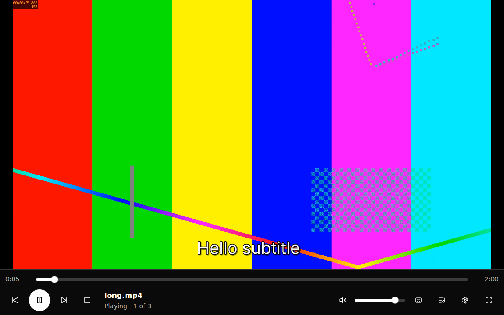
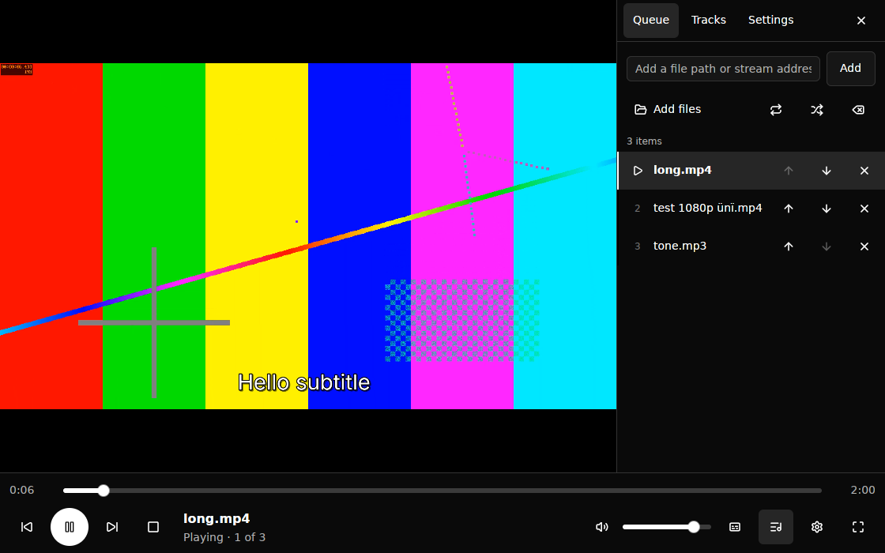
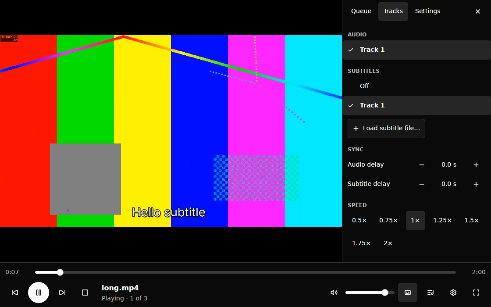
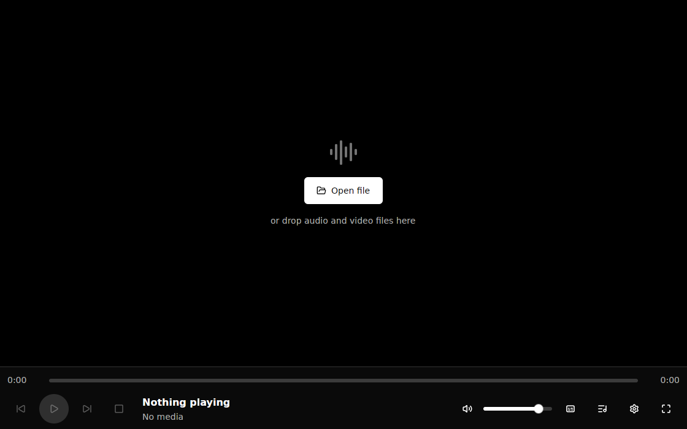

# Mono Player

A fast, low-overhead desktop media player with a strictly monochrome interface.
Rust + [GPUI Kit](https://gpui-kit.com) for the UI, LibVLC (through
[`vlc-rs`](https://crates.io/crates/vlc-rs)) as the playback engine, rendering video
directly into a native child surface — no per-frame CPU copies.



| Queue | Tracks, sync & speed | Empty state |
|---|---|---|
|  |  |  |

## Status

| Platform | Video output | Status |
|---|---|---|
| Linux, X11 | X11 child window + InputOnly input overlay | **Verified** (see [spike report](docs/SPIKE-REPORT.md)) |
| Linux, Wayland session | Runs on XWayland automatically (same X11 path) | Implemented; needs validation on a real compositor |
| Linux, native Wayland (`MONO_PLAYER_WAYLAND=1`) | LibVLC's own window (PRD fallback 2) | Fallback only |
| Windows | Child `HWND` | Implemented and type-checked; **not yet run on Windows** |
| macOS | `NSView` subview | Implemented and type-checked; **not yet run on macOS** |

The PRD's Phase 0 gate passes on Linux/X11. Windows and macOS adapters exist behind the same
interface and compile for their targets, but must pass the same spike checklist on real hardware
before release.

## Features

- Open files (picker, drag and drop, command line), stream URLs (http/https/rtsp/…), Unicode
  and space-containing paths.
- Play/pause/stop, seek (one engine seek on slider release), ±5 s / ±30 s keyboard seeking,
  volume and mute, speed 0.5×–2×, fullscreen with auto-hiding controls.
- Session queue: add, remove, reorder, previous/next, repeat off/all/one, shuffle, virtualized
  list, failed items marked in place.
- Audio and subtitle track selection, external subtitles (drop or load), subtitles off,
  audio and subtitle delay.
- Recent media, resume where playback stopped, remembered volume and window geometry — in one
  small versioned JSON file, with switches to disable and clear history.
- Plain-language errors without modals: missing file, permission, folder, invalid/unsupported
  address, unsupported or corrupt media, unreachable stream, engine start failure.

## Building

Requirements: a recent stable Rust toolchain (developed with 1.97) and the LibVLC 3 SDK.

```sh
# Debian/Ubuntu
sudo apt install libvlc-dev vlc-plugin-base \
  libxkbcommon-dev libxkbcommon-x11-dev libwayland-dev libx11-xcb-dev \
  libvulkan-dev libfontconfig-dev libfreetype-dev libxcb1-dev

cargo run --release -- path/to/video.mkv path/to/video.srt
```

On Windows and macOS, point the linker at the LibVLC SDK from the official VLC distribution
(`libvlc.lib` / `libvlc.dylib`) and ship its `plugins` folder; see
[docs/PACKAGING.md](docs/PACKAGING.md).

Debug builds compile all dependencies with `opt-level = 2` (GPUI Kit's guidance) so the UI is
representative while our own crate stays fast to rebuild.

## Keyboard shortcuts

| Key | Action | Key | Action |
|---|---|---|---|
| Space | Play / pause | ↑ / ↓ | Volume up / down |
| S | Stop | M | Mute / unmute |
| Ctrl/Cmd+O | Open files | P / N | Previous / next item |
| F | Toggle fullscreen | L | Show / hide queue |
| Esc | Exit fullscreen (or close panel) | T | Tracks, sync & speed |
| ← / → | Seek 5 s | [ / ] | Slower / faster |
| Shift+← / → | Seek 30 s | Ctrl/Cmd+, | Settings |
| Ctrl/Cmd+Q | Quit | | |

Shortcuts are defined once in `src/actions.rs`; the in-app list (Settings panel) is generated
from the same table. Player keys never fire while a text field has focus.

## Testing

```sh
cargo test                          # everything
cargo test --lib                    # pure logic: state, playlist, settings, theme contrast…
cargo test --test playback_adapter  # the playback actor against the installed LibVLC
cargo test --test ui                # the real view in a headless GPUI Kit window
cargo clippy --all-targets -- -D warnings
```

The LibVLC tests generate their own WAV media and do not need an audio device. Set
`MONO_PLAYER_SKIP_LIBVLC_TESTS=1` on machines without LibVLC plugins.

## Configuration

| Variable | Effect |
|---|---|
| `MONO_PLAYER_CONFIG_DIR` | Settings directory (default: platform config dir) |
| `MONO_PLAYER_LOG=1` | Lifecycle tracing on stderr (LibVLC start time, teardown) |
| `MONO_PLAYER_WAYLAND=1` | Use native Wayland instead of XWayland (video then opens in LibVLC's own window) |
| `VLC_PLUGIN_PATH` | Override the LibVLC plugin directory |

Nothing is sent over the network except the media you open. There is no telemetry.

## Documentation

- [Architecture](docs/ARCHITECTURE.md) — layers, threading, event flow, lifecycle.
- [Spike report](docs/SPIKE-REPORT.md) — Phase 0 video-surface validation, measurements,
  findings, and what remains to verify per platform.
- [Packaging and licensing](docs/PACKAGING.md) — bundling LibVLC and plugins, notices.
